<div align="center">
  <h1>Food Focus AI</h1>
  <h3>AI-Powered Food Calorie Tracking System Using Vision Transformer</h3>
  <p>Accurate Indian food recognition and nutritional analysis powered by deep learning</p>
</div>

---

## Project Overview

**FoodFocus AI** is an intelligent food recognition and calorie tracking system designed specifically for **Indian cuisine**.  
The system leverages **Vision Transformer (ViT)**–based deep learning models to identify food items from images and estimate their nutritional values, enabling users to make informed dietary decisions.

By simply uploading or capturing an image of a meal, users receive **instant food identification**, **calorie estimation**, and **macronutrient breakdown**, presented through an intuitive web interface.

---

##  Key Objectives

- Accurately recognize diverse Indian food items from images  
- Estimate calories and macronutrients automatically  
- Provide real-time feedback through a user-friendly web application  
- Support personalized dietary monitoring and nutrition awareness  

---

##  Core Features

- **AI-Powered Food Recognition**  
  Vision Transformer–based model trained on Indian food datasets for high-accuracy classification.

- **Nutritional Analysis**  
  Displays calorie count along with proteins, carbohydrates, and fats.

- **Real-Time Inference**  
  Optimized model pipeline delivers predictions within seconds.

- **Interactive Web Interface**  
  Clean and intuitive UI for image upload, results visualization, and tracking.

- **Personalized Tracking**  
  Enables users to monitor daily intake and maintain dietary goals.

---

## System Architecture & Workflow

## Getting Started

### Prerequisites
- Python 3.8+
- Node.js 16+
- npm or yarn

### Installation

1. Clone the repository:
```bash
git clone https://github.com/Jeevakrishna/FoodFocus-AI-Food-Calorie-and-Tracking-System-using-ViT-transformer-.git
cd FoodFocus-AI-Food-Calorie-and-Tracking-System-using-ViT-transformer
```

2. Set up the backend:
```bash
# Install Python dependencies
pip install -r requirements.txt

# Set up environment variables
cp .env.example .env
```

3. Set up the frontend:
```bash

npm install
```

## Project Structure

```
FoodFocus-AI/
├── api/                      # FastAPI backend
│   ├── app/                 
│   │   ├── models/           # ML models
│   │   ├── routes/           # API endpoints
│   │   └── utils/            # Helper functions
│   └── requirements.txt      # Python dependencies
│             
|──── public/               # React frontend   
|──── src/
│       ├── components/       # React components
│       ├── pages/            # Application pages
│       └── styles/           # CSS/SCSS files
│
├── notebooks/                # Jupyter notebooks for model development
├── data/                     # Datasets and processed data
├── models/                   # Saved model weights
├── .gitignore
└── README.md
```

## Running the Application

1. Start the backend server:
```bash
cd api
uvicorn app.main:app --reload
```

2. In a new terminal, start the frontend:
```bash
npm start
```

3. Open [http://localhost:3000](http://localhost:3000) in your browser.

## Model Training

To train the ViT model:
```bash
python train.py --data_dir ./data --epochs 50 --batch_size 32
```

## System Architecture & Workflow
```bash

flowchart LR
    A[User Uploads Food Image] --> B[Image Preprocessing]
    B --> C[Vision Transformer (ViT)]
    C --> D[Food Classification]
    D --> E[Calorie & Nutrient Estimation]
    E --> F[Web Dashboard]
    F --> G[User Insights]

```

#  List of Figures
| Fig No | Description |
|--------|-------------|
| Fig 1 | System Architecture Diagram | 
| Fig 2 | Architecture of ViT Transformer | 
| Fig 3 | Food Categories Graph | 
| Fig 4 | Sample Food Images from Dataset | 
| Fig 5 | Confusion Matrix | 
| Fig 6 | Training and Validation Loss | 
| Fig 7 | Training and Validation Accuracy | 
| Fig 8 | Food Model API | 
| Fig 9 | Analysis of Feature Extraction | 
| Fig 10 | Classification Models Comparison with Proposed Hybrid Transformer Model | 
| Fig 11 | Food-Focus Webpage | 


# List of Tables

| Table No | Description | 
|----------|-------------|
| Table 1 | Food Categories Count with Calorie Values | 
| Table 2 | Feature Extraction Analysis of the VGG Model | 
| Table 3 | Comparison of Classification Models with Proposed Hybrid Transformer Model | 

**Abbreviations**

| ML | Machine Learning |
| :---- | :---- |
| DL | Deep Learning |
| ANN | Artificial Neural Network |
| CNN | Convolutional neural networks |
| MuGIF | Mutually Guided Image Filtering  |
| VGG | Visual Geometry Group |
| ViT | Vision Transformer |
| ST |  Swin Transformer |
| IDBA | Improved Discrete Bat Algorithm  |
| MSE | Mean Square Error |
| R2 | Coefficient of determination |
| SVM | Support Vector Machine  |


# **ABSTRACT**

 This study presents a robust approach for continuous food recognition essential for nutritional research, leveraging advanced computer vision techniques. The proposed method integrates Mutually Guided Image Filtering (MuGIF) to enhance dataset quality and minimize noise, followed by feature extraction using the Visual Geometry Group (VGG) architecture for intricate visual analysis. A hybrid transformer model, combining Vision Transformer and Swin Transformer variants, is introduced to capitalize on their complementary strengths. Hyperparameter optimization is performed using the Improved Discrete Bat Algorithm (IDBA), resulting in a highly accurate and efficient classification system. Experimental results highlight the superior performance of the proposed model, achieving a classification accuracy of 99.83%, significantly outperforming existing methods. This study underscores the potential of hybrid transformer architectures and advanced preprocessing techniques in advancing food recognition systems, offering enhanced accuracy and efficiency for practical applications in dietary monitoring and personalized nutrition recommendations**.**

 

**KEY WORDS**: Mutually guided image filtering, Visual geometry group, Vision transformer, Swin transformer, Improved discrete bat algorithm

## **Table of Contents**
| Chapter | Section | Title |
|-------|---------|-------|
| 1 | — | **Summary of Base Paper** |
|  | 1.1 | Introduction |
|  | 1.2 | Related Work |
|  | 1.3 | Problem Statement |
|  | 1.4 | Objective |
|  | 1.5 | Proposed Solution and System Architecture |
|  | 1.6 | Methodology and Implementation |
| 2 | — | **Merits and Demerits of Base Paper** |
|  | 2.1 | Merits |
|  | 2.2 | Demerits |
| 3 | — | **Snapshots** |
|  | 3.1 | Train Food Model |
|  | 3.2 | Model Performances and API Development |
|  | 3.3 | Graphical User Interface Using Flask |
| 4 | — | **Conclusion and Future Plans** |
|  | 4.1 | Conclusion |
|  | 4.2 | Future Plans |
| 5 | — | **References** |
| 6 | — | **Appendix – Base Paper** |


#          CHAPTER 1
#       **SUMMARY OF BASE PAPER**  

| Title | :  | Recognition of food type and calorie estimation using  neural network  |
| :---- | :---- | :---- |
| **Publisher** | : | Dinesh Kumar.R |
| **Year** | : | 2021 |
| **Journal** | : | The Journal of Supercomputing ,Volume 77,pages 8172–8193,Article 11227  |
| **Indexing** | : | SCI / Scopus |
| **Base paper URL** | : | [https://link.springer.com/article/10.1007/s11227-021-03622-w\#](https://link.springer.com/article/10.1007/s11227-021-03622-w#) |

## **1.1 INTRODUCTION** 

Many people are interested in eating junk food and soft drink which have more sugar content and high calorifc value. Due to less exercise and lack of knowledge about the dietary food and uncontrollable eating habits among the people, there is an increase in obesity level. There are several issues related to obesity like hyper tension, diabetics, cardiac issues, breathing problems etc. Obesity causes people to have ligament damages in their knee or other joints due to over body weight. They also have breathing issues while walking or climbing staircase and heart gets excess strain in pumping the blood all over the body. A diabetic is a  condition in which the insulin production in the human body gets reduced and leads to increase in the sugar content in the blood. Imbalanced dietary food habit  and consuming food with less nutrient and more calorifc values are the main reason  for obesity. Proper dietary and  balanced food with regular exercise can reduce the  obesity level and also helps to have a healthy life with normal body mass index (BMI)  level. By having measured food volumeswhich have high nutrient fbre and less calories can help in losing weight.It isvery difcult for a person to measure the food volume and have knowledge aboutthe nutrient content in each food. Hence, everyone  needs an assistant or systemto give information about the food volume and calories  and guide them. 

It is verydifcult to have a dietician every time with everyone to guide about the food. They need an automated system which can assist anyone anytime just by using an image of the food and give detail information about its volume and nutrients. Visual perception of an image is mainly based on the colour and its texture. In this proposed image processing system, image resizing, feature extraction, segmentation, and classifcation are performed. Multilayer perceptron (MLP) is used for classifcation and based on the food volume the calorifc value is calculated.Digital imaging’s promisingly have better results in recognition food items and calculating food calories over other traditional methods. Recognizing food items and calorie estimation to maintain proper dietary information are still a research  
challenging task and problem. We proposed an algorithm an improved MLP for recognizing food items with high performance and accuracy. The main objective of the proposed work is to provide computer-based solution to maintain proper dietary intake and BMI.

## **1.2 RELATED WORK** 

During the adolescence period, everyone will undergo many changes in both  physiological and psychological aspects. Eating habits get modifed as they start  to decide what they want to eat. It is very difcult for them to maintain proper  balanced diet with regular physical activity. Both physical activity and nutrition are linked and helps in maintaining a normal health with reducing health hazards \[1\].

For any expert dietician, it is very difcult to give the full information about the nutrition value from seeing a plate of food. This is because salt, sugar, fruits, vegetables, meat, oil contents cannot be examined without tasting. But in case  of natural foods like vegetables and fruits, it is easy for them to give the nutrient values. Based on the proteins, carbohydrates and fats contents present in the food, its energy or calories are calculated. A balanced diet with required calories will help in maintaining proper BMI. Table 1 shows sample of fruits, vegetables, nuts and their corresponding calories values based on the international food standards \[2\]. 

Generally, a clinical technician or dietician used to monitor the inpatient food and drinks intake and note the dietary information and make a record of them. In case of out-patients, it is not easy to get all the details. Since patient cannot remember all the food and drinks he/she has taken. From this, it is clear that manual approach of calculating the dietary information is very difcult one. Hence, an automated system giving information about the nutrient and calories contents in a food is required. To overcome the drawbacks in the clinical methods, improved methods with fast response are developed by several researchers. Simple image of the food is given to the system which automatically calculates the amount of calories present in that \[3\]. 

Artifcial intelligence feld is gaining more interest among the researches and used in many real-time practical application. Like humans, the AI system is must take instantaneous solution for a problem. This is achieved by giving required knowledge, data and trains them to solve the problem efectively. Many research ers use ANN, SVM, CNN, KNN, decision tree and other methods to classifying the fruits and vegetables \[4\]. 

Amazon Recognition, Vision AI, Computer Vision and Clarifai are some of the  deep learning platforms which are developed for identifying or detecting logos, celebrity, emotions, objects, texts, foods, vegetables, places etc..Convolutional neural network model is used for food classifcation by providing information such  as name of the food, calories and nutrition value \[5\]

## **1.3 PROBLEM STATEMENT** 

Current food tracking systems face significant limitations when it comes to accurately identifying Indian foods, often resulting in inconsistent and unreliable calorie data. Generic tracking methods lack the precision needed to represent the complexity of Indian meals, which typically consist of multiple ingredients and diverse preparation techniques. This inaccuracy makes it challenging for users to manage their diets effectively, especially those with specific health or nutritional goals. The rich diversity of Indian cuisine ranging from regional variations to intricate cooking methods poses a major challenge for existing food tracking solutions, which often fail to account for these complexities.

## **1.4 OBJECTIVE** 

The proposed solution implements Vision Transformer (ViT) model to accurately identify food items and calculate their nutritional content, effectively overcoming the limitations of current systems. It provides real-time tracking complemented by intuitive and user-friendly visuals to improve user engagement and clarity. The system enables users to set and monitor personalized daily nutrition goals, offering tailored insights to support their dietary management. Progress is visualized through interactive calendars and charts, ensuring that food tracking remains simple, accessible, and effective for all users.

## **1.5 PROPOSED SOLUTION AND SYSTEM ARCHITECTURE** {#1.5-proposed-solution-and-system-architecture}

### **1.5.1 IMPLEMENTATION** 

The Visual Geometry Group (VGG) from the University of Oxford developed a deep learning algorithm known as VGG, following the success of AlexNet. Designed to enhance performance in the 2014 ILSVRC competition, the VGG network architecture includes 13 convolutional layers and 3 fully connected layers, forming a total of 41 layers when combined with MaxPool, ReLU, Dropout, and Softmax layers. The final layer of this architecture is a classification layer, and the model requires input images of size 224×224×3. Unlike other architectures with numerous hyperparameters, VGG adopts a more straightforward and uniform structure, which simplifies the overall design. Variants such as VGG16 and VGG19 are distinguished by the number of layers they contain.

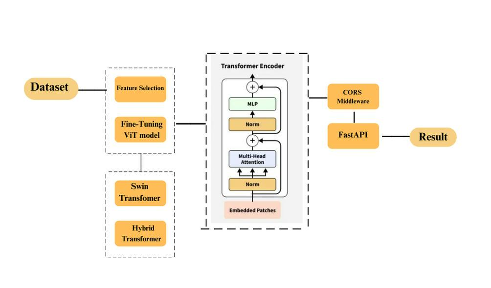

**Fig. 1**. System architecture Diagram

**1.6  METHODOLOGY**  
Figure 2 shows the work flow of the proposed food classification model using  ViT Transformer

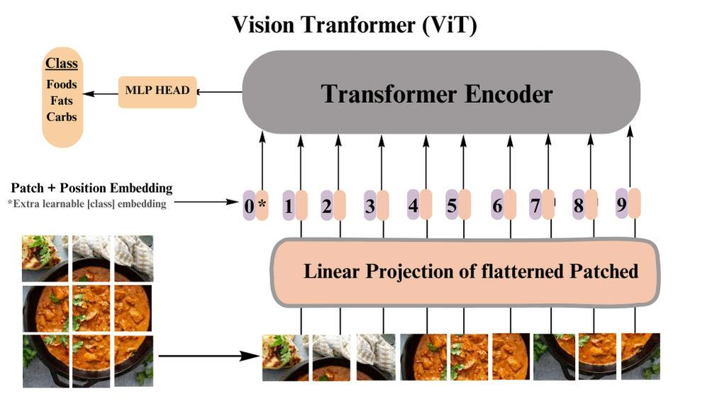
 **Fig. 2**. Architecture of Vit Transformer  

**1.6.1 Data acquisition**  
Figures 1 and 2 list the different food categories along with the calorie counts used for this investigation. Various physical characteristics and health impacts were taken into consideration when selecting common foods for the experiments. If Nutrition Facts were available, the measured weight and the calorie-per-weight value were used to calculate the calorie counts for each food. For foods lacking Nutrition Facts, measured weights and a variety of nutritional data from the food caloires dataset published data on calorie-per-weight,food composition, cooking methods, and other topics were used to compute the calorie values. In this study, actual calculated caloric values were obtained without the need for food analysis equipment because the sample location could affect the values produced by unevenly distributed food ingredients. Furthermore, using visual cues to estimate representative caloric counts was the goal, so using values from a reputable organization was reasonable. By using the same amount of food in the same cup, all liquid foods were collected. This was done to mitigate any negative effects on food classification and calorie estimation that might result from varying cup shapes and volumes. There were numerous food pairings that had the same appearance but different nutritional values, such as cider and water, tofu and milk pudding, milk soda and milk, and coffee and coffee with sugar.These foods were selected carefully to demonstrate the value of UV and NIR pictures for food categorization and calorie calculation.

**1.6.2 Preprocessing using mutually guided image filtering (MuGIF)**  
Frequency domain filtering and spatial filtering are the two main categories of image filtering. Specifically, spatial filtering is a technique used to improve or alter images based on predetermined guidelines. Usually, it has the following expression:


T0 and T indicate the output and input signals respectively, Ψ (T,T0) symbolises the term for fidelity, Φ (T) represents the output’s regularisation term, and *α* is a coefficient that is non-negative and balances these two terms.  

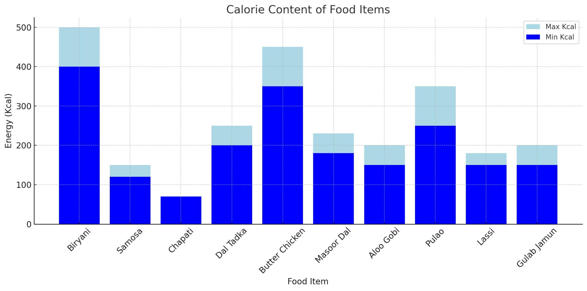  
      				**Fig. 3**. Food categories graph.

| Food Item |  Energy (Kcal) |      Protein(g) | Carbohydrates(g) | Fats (g) |
| :---- | :---- | :---- | :---- | :---- |
| Briyani (1 serving) | 400-500 | 15 | 60 | 15 |
| Samosa (1piece) | 120-150 | 3 | 18 | 7 |
| Chapathi(1piece) | 70 | 2 | 15 | 1 |
| Dal Tadka(1 serving) | 200-250 | 12 | 30 | 8 |
| Butter Chicken(1 serving) | 350-450 | 25 | 10 | 25 |
| Masoor Dal(1serving) | 180-230 | 12 | 30 | 5 |
| Aloo Gobi(1 serving) | 150-200 | 5 | 20 | 6 |
| Pulao (1 serving) | 250-350 | 6 | 50 | 8 |
| Lassi (1 glass) | 150-180 | 5 | 20 | 5 |
| Gulab jamun (1piece) | 150-200 | 2 | 30 | 8 |

**Table.1**. Food categories count with calorie count.

In order to optimise the guided image’s information and portray the target image T’s relative structure to reference R, which is defined as the identical structural relationship that exists between the two images:  

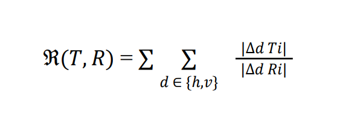
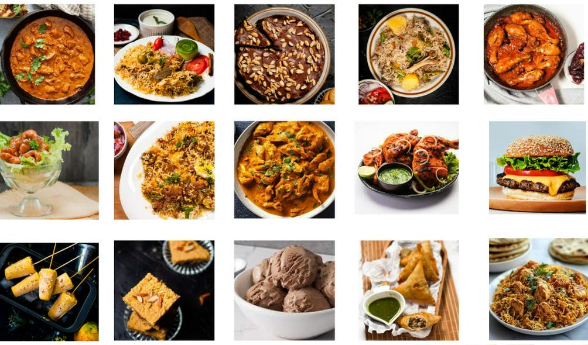  
				**Fig. 4** Sample food image from dataset

wherein *i* represents a pixel in the picture (*x, y*) and *∇d* symbolises an initial derivative filter concerning the vertical (*v*) and horizontal (*h*) directions. The proportionate arrangement *R*(*T,R*) determines the structural variation between T and R.

The following can be used to create the muGIF optimisation objective using the definition of relative structure:

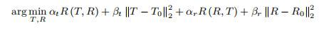
*αt, αr, βt*, and *βr* are employed as non-negative constants to keep the corresponding terms balanced; denotes the *l*2 norm, *|T − T*0*| 2*2 and *|R − R*0*|* 22 are used to prevent T and R from straying too far from *T*0 and *R*0.

It is difficult to solve the optimisation problem above directly. First, attempting to find a close replacement for the relative structure *R*(*T,R*):  

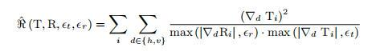

where *ϵt* and *ϵr* are included to avoid division errors by zero. The corresponding optimisation objective can be replaced using the form below:


wherein *t, t*0*, r and r*0 are the graphical representations of *T,T*0*, R* and *R*0 accordingly. Let *Qd* and P*d* (*d ∈ {h, v}*) show the *i*th diagonal element’s diagonal matrices max(*|∇* 1 *DTd*  *i|,et*) and max(*|∇* 1 *dRi|,er*) correspondingly. Consequently, the goal Function (5) is changed into

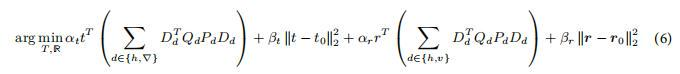

Herein, *DTd* in the d direction, is the discrete gradient operator’s Toeplitz matrix. After muGIF filtering,Alternating Least Squares (ALS) can be used to solve Eq. (6) and get the desired outcome.  

  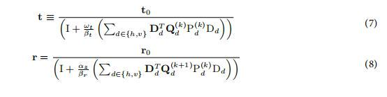
  
**1.6.3 Vision transformer**  
In computer vision, Vision Transformers (ViTs) are a cutting-edge method that challenges conventional convolutional neural networks (CNNs) in image processing applications. ViTs have demonstrated remarkable success in several computer vision benchmark tests. They are an extension of the transformer architectures initially developed for natural language processing. ViTs are based on a pure transformer architecture as opposed to conventional CNN. The ability of Vision Transformers to process a given patch while weighing the significance of various patches is made possible by the self-attention mechanism. This mechanism makes the model very effective for understanding images by allowing it to capture contextual information and long-range dependencies. An attention matrix is produced by the self-attention mechanism, determining the attention scores in the input sequence between every pair of positions. During the information aggregation process, the significance of each patch is then evaluated using this matrix. The capacity to focus on various areas of the image simultaneously improves Vision Transformers’ awareness of their global context. A series of embeddings, each corresponding to a position in the input sequence, serves as the input for the self-attention block. Within the input sequence,the embeddings represent different positions or tokens. Three vectors are created from the embeddings for every position: key, query, and value, through linear transformations, respectively; the Vision Transformer learns these transformations during training. The output of a Transformer’s self-attention block is a weighted sum of the embeddings it received, derived from attention scores indicating the connections between various input sequence positions. To obtain value, key, and query vectors from each input embedding, linear transformations are applied, and the dot product of the query with the key vectors is used to calculate attention scores. The softmax function is then used to normalize these scores, creating weights reflecting the significance of each position. Each position in the result attends to other positions based on their relevance, obtaining contextual information from the entire input sequence. One important element that enhances Vision Transformers (ViTs) is their possession of multiple heads that work together to control their attention, allowing the model to identify various patterns and connections in visual input. Concatenation and linear transformation are used to combine the outputs of these parallel attention heads into a final multi-head attention system.  

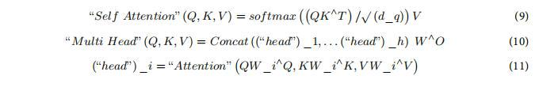

The activation functions consisting of a rectified linear unit (ReLU), two linear activation functions, and a point wise feedforward network (FFN) receive the multi-head output of the self-attention block are integrated. First and second linear layer weight matrices are represented by X  
   
*FFN \= ReLU (XWa \+ Ba ) Wb \+Bb*                                                                     (12)

**1.6.4 Swin transformer**

Local–global relationships and spatial hierarchies in images can be more easily captured with the Swin Transformer, thanks to its hierarchical structure and movable windows. The way the Swin Transformer works is similar to how ViT does: With the use of a proprietary patch splitting module, it divides the input image into distinct, non-overlapping patches. Every patch is regarded as a "token," and the RGB values of its raw pixel values are combined to form its features. These raw-valued features are then projected into any dimension, C, by means of a layer of linear embedding. The patch tokens in question are then subjected to a set of transformer blocks called Swin Transformer blocks, which include adjusted self-attention calculations. “Stage 1” is formed by these transformer blocks using the linear embedding, maintaining the initial token count. As the network gets deeper, for the purpose of creating a hierarchical representation, fewer tokens are employed via a layer for patch merging. By covering the 4C-dimensional concatenated features with a linear layer and merging the features of each 2×2 neighboring patch group, the first patch merge layer lowers the quantity of tokens by four times. The term “Stage 2” describes this initial feature


**1.6.5 Hyper parameter tuning using IDBA**  
One major improvement strategy is to map the formulations of displacement and continuous velocity into combinatorial optimization operators. The Improved Discrete Bat Algorithm (IDBA) is designed to optimize the hyperparameters of the hybrid transformer model. The architecture of IDBA involves key components such as population initialization, fitness  
evaluation, velocity and position update mechanisms, and local search strategies. The main features include:

• **Population initialization:** A population of bats is initialized with random solutions representing hyperparameter combinations.

• **Velocity and position update:** Each bat updates its velocity and position using a dynamic adjustment formula inspired by bat echolocation, ensuring exploration and exploitation in the solution space.  
• **Fitness evaluation:** The fitness of each bat (solution) is evaluated based on the classification accuracy of the model.

• **Local search strategy:** A local search mechanism enhances convergence by fine-tuning promising solutions.

• **Selection mechanism:** Bats with the best fitness values are retained for the next iteration, driving the algorithm toward the optimal solution*.*

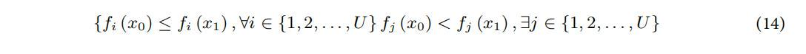

**1.6.6 Performance metrics**  
The dataset was used to create a classification system, and four main analytical metrics were created to assess its performance: false negative (TN), false positive (FP), true positive (TP), and false negative (FN). A classification model’s effectiveness is assessed by calculating true assumptions to total assumptions of the assumptions that were made (ACC):

                           *Accuracy(ACC) \= TP \+ TNTP \+FP+ TN \+FN*                               (15)

The number of positively detected examples relative to all positive examples is measured by the positive predictive value, or PR:

			*Precision (PR) \= TPTP \+FP*                                       				      (16)

The proportion of cases classified as positively out of each positive instance is referred to as the real-positive rate (TPR) or sensitivity

  			*Recall (RC) \= TP TP  \+FN*														      (17)

F1 is an individual numerical value that represents a metric that combines PR and RC:


  *F1-score (F1) \= Precision \* RecallPrecision \+ Recall*                                            (18)


#      **2 MERITS AND DEMERITS OF BASE PAPER**  

## **2.1 MERITS**  

* **High Accuracy and Innovation** this paper achieves an impressive 99.83% accuracy in food recognition by combining Vision Transformer (ViT) and Swin Transformer, which is a novel approach in this field.   
* **Effective Preprocessing** \-The use of Mutually Guided Image Filtering (MuGIF) helps clean up noisy images, making the system more reliable under different lighting conditions and camera angles.   
* **Strong Feature Extraction** \-The VGG architecture is well-suited for capturing fine details like texture and color, improving the model’s ability to distinguish between similar-looking foods.   
* **Smart Optimization** \- The Improved Discrete Bat Algorithm (IDBA) fine-tunes the model’s parameters efficiently, leading to better performance compared to traditional optimization methods.   
* **Thorough Testing** \- The model is rigorously tested against existing methods (e.g., CNNs, standalone transformers) and shows clear improvements in accuracy, precision, and recall.

## **2.2 DEMERITS**   

* **Limited Real-World Application** \- While the model performs well in experiments, it hasn’t been tested extensively in real-life scenarios (e.g., messy plates, mixed dishes), which could affect its practical use.   
* **High Computational Cost** \- The hybrid transformer approach and IDBA optimization may require powerful hardware, making it less suitable for mobile or low-power devices.   
* **Dataset Bias** \- The training data may not cover enough global food varieties, meaning the model might struggle with less common or culturally specific dishes.   
* **Simplified Calorie Estimation** \- The system estimates calories based on food volume and pre-defined tables, ignoring factors like cooking methods or ingredient variations that affect actual nutritional content.  
* **No User Feedback**\-There’s no testing with real users (e.g., in a dietary app), so it’s unclear how easy or practical the system would be for everyday use.


#      **3 . SNAPSHOTS** 

### **3.1 Train\_food\_model** 

**3.1.1  Confusion Matrix**

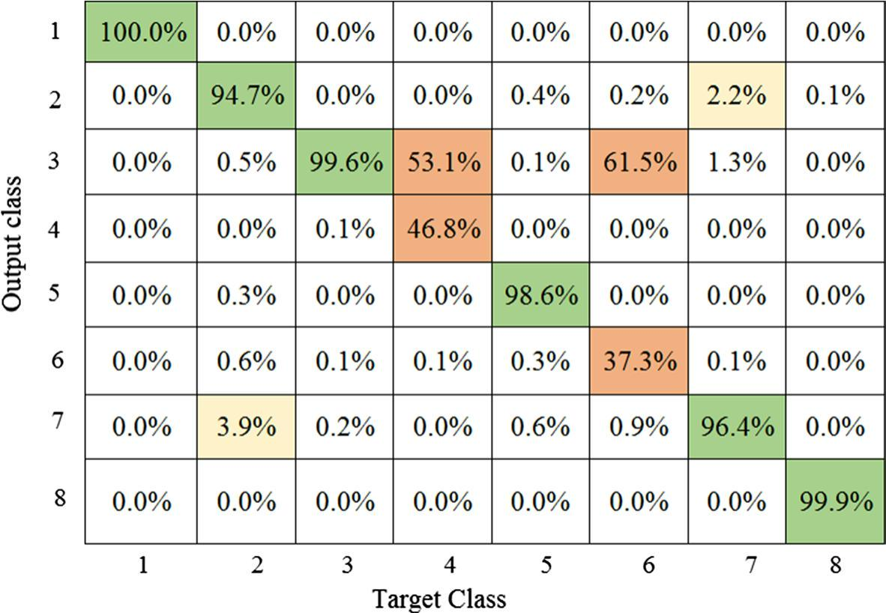  
				**Fig**.5. Confusion Matrix

Precision value is calculated with the exactly predicted values through the total amount of values, recall is measured through the positive values of the whole absolute precision values. F1-score is computed through the average weighted values of precision and recall that the false positive values are used to distribute the class values. The accuracy value is measured through the ratio of exactly predicted valuesaccording to the total amount of values. With respect to detailed survey on food item recognition, quality results and better performance are obtained from SVM. So, SVM classifer is taken as the baseand the results are compared with improved MLP. From the results attained, it isobserved that proposed MLP algorithm provides better performance and classifcation accuracy when compared to other existing food item recognition techniques.

**3.1.2 Training and Validation loss**

 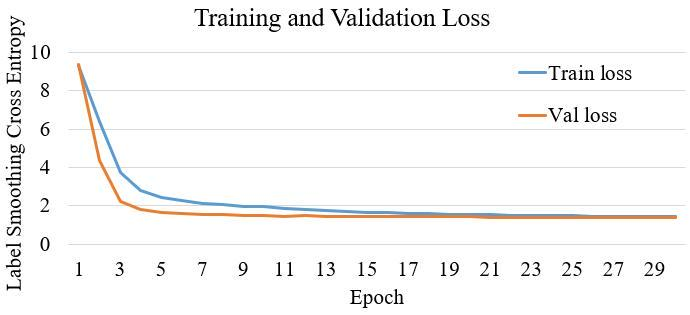
                                              **Fig**.6. Training and Validation loss   
**3.1.2 Training and Validation Accuracy**

 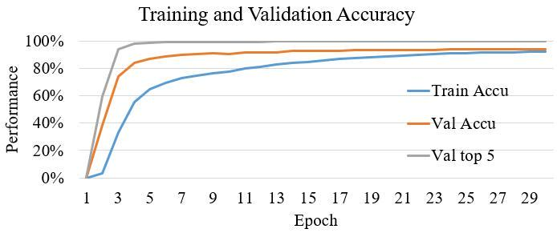 
				**Fig**.7. Training and Validation Accuracy

Top-5 accuracy, increases with more training epochs and eventually plateaus. At the end of training, we achieved 92.2% training accuracy, 94.1% Top-1 validation accuracy, and  
99.7% Top-5 validation accuracy. The model with the highest Top-1 validation accuracy was saved and used for inference on the test dataset, which contained 311,859 images across  
2,000 classes. On the test set, the model achieved 95% Top-1 accuracy and 99.8% Top-5 accuracy, as reported in Table I (bottom row). NoisyViT with a 384 × 384 resolution consists  
of 348 million parameters and has an inference time of 6.81ms per image. We also evaluated NoisyViT with a 224 × 224 resolution, and the results are reported in Table I (second row  
fromthebottom).Thisvariantachieved94.1%Top-1accuracy and 99.8% Top-5 accuracy, closely matching the performance of the higher-resolution model.
 

**3.2 Feature Selection**   
**3.2.1 Feature extraction analysis of the VGG model**  
 

| Methods | Accuracy (%) | Precision (%) | Recall (%) | F1 score (%) |
| :---- | :---- | :---- | :---- | :---- |
| AlexNet | 95.07 | 95.88 | 94.19 | 95.03 |
| ResNet | 96.88 | 96.81 | 94.95 | 96.88 |
| GoogleNet | 97.45 | 97.57 | 97.33 | 97.45 |
| XceptionNet | 98.50 | 98.57 | 98.42 | 98.50 |
| Proposed VGG model | 99.77 | 99.72 | 99.63 | 99.73 |

			**Table.**2\. Feature extracion analysis of the VGG model

**Feature extraction validation**  
Table 2 provides the feature extraction validation analysis of the proposed VGG model with other existing models.Table 2 presents a comprehensive feature extraction analysis comparing various DL models, including AlexNet, ResNet, GoogleNet, XceptionNet, and a proposed VGG model. Each model’s performance metrics are displayed, including F1 score, recall, accuracy, and precision. AlexNet achieved an accuracy of 95.07%, with  
recall, precision, and F1 score values of 95.88%, 94.19%, and 95.03%, respectively. ResNet demonstrated higher accuracy at 96.88%, along with recall, precision, and F1 score all hovering around 96.88%. GoogleNet further improved the metrics with an accuracy of 97.45% and recall, precision, and F1 score values peaking at 97.57%,97.33%, and 97.45%, respectively. XceptionNet continued the trend of improvement, achieving an accuracy of 98.50% and exhibiting recall, precision, and F1 score values of 98.57%, 98.42%, and 98.50%. The proposed VGG model outperformed all others, achieving an exceptional accuracy of 99.77%, with recall, precision, and F1 score values of 99.72%, 99.63%, and 99.73%, respectively, indicating its superiority in feature extraction analysis.

  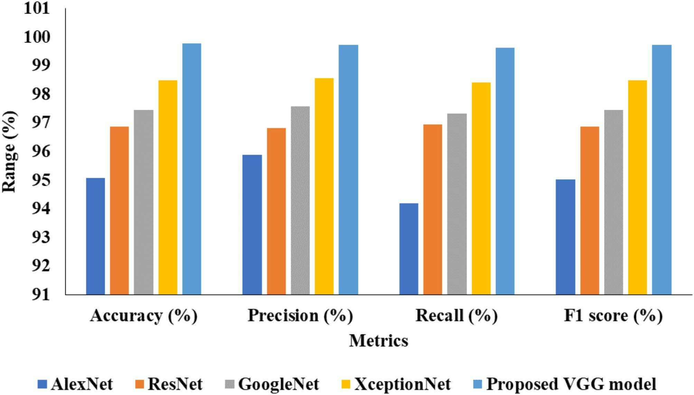
				**Fig.** 9\. Analysis of feature extraction.

**3.2.2 Performance Metrics**  
 

| Methods | Accuracy (%) | Precision (%) | Recall (%) | F1 score (%) |
| :---- | :---- | :---- | :---- | :---- |
| AlexNet | 95.07 | 95.88 | 94.19 | 95.03 |
| ResNet | 96.88 | 96.81 | 94.95 | 96.88 |
| GoogleNet | 97.45 | 97.57 | 97.33 | 97.45 |
| XceptionNet | 98.50 | 98.57 | 98.42 | 98.50 |
| Proposed VGG model | 99.77 | 99.72 | 99.63 | 99.73 |

      **Table.3.** Comparison of classification model with proposed Hybrid Transformer model  
Table 3 presents a comprehensive comparison of various classification models with the proposed Hybrid Transformer model. The performance metrics of each method are highlighted for comparison, including precision, accuracy, recall, and F1 score. The Artificial Neural Network (ANN) achieved an accuracy of 97.08%, with recall, precision, and F1 score values of 96.43%, 97.09%, and 96.90%, respectively. The CNN demonstrated a slightly higher accuracy of 97.14%, along with recall, precision, and F1 score values of 97.48%, 
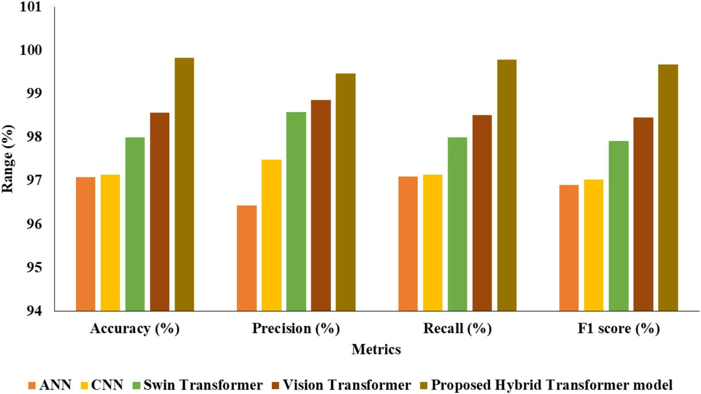
**Fig. 9**. Classifcation models comparison with proposed Hybrid Transformer model.

97.14%, and 97.02%, respectively. Swin Transformer improved upon these metrics, achieving an accuracy of 98.00%, with recall, precision, and F1 score values of 98.58%, 98.00%, and 97.92%, respectively. Vision Transformer further enhanced the performance, attaining an accuracy of 98.57%, with recall, precision, and F1 score values of 98.86%, 98.51%, and 98.46%, respectively. However, the proposed Hybrid Transformer model outperformed all other methods, achieving exceptional accuracy of 99.83%, with recall, precision, and F1 score values of 99.47%, 99.79%, and 99.67%, respectively, indicating its superiority in classification tasks. 

**3.4 Web Inrerface**  
**3.4.1 Graphical user interface using React Js**

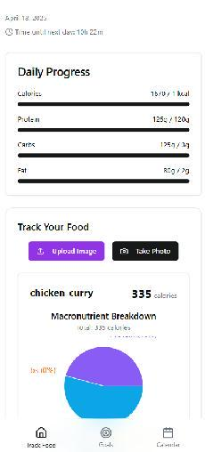  
                                       **Fig.**11**.** Food-focus Webpage

Users will be able to upload or capture food images to receive instant, detailed nutritional breakdowns, including calories, protein, fats, and carbohydrates. With features such as a progress calendar marking achieved and missed goals, macronutrient visualization via interactive pie charts, recent entries logging, exportable data, personalized meal suggestions, and engaging food facts,


# **4\. CONCLUSION AND FUTURE PLAN**

				

## **4.1 CONCLUSION** 

## This study presents a robust hybrid transformer-based food recognition system that integrates advanced preprocessing, feature extraction, and optimization techniques to enhance precision and bridge existing gaps in food tracking tools. Leveraging a combination of Vision Transformer and Swin Transformer architectures, along with Mutually Guided Image Filtering (MuGIF) and the Visual Geometry Group (VGG) network, the system achieves a high classification accuracy of 99.83%, effectively addressing challenges such as variability in food presentation, environmental factors, and limited dataset quality.

##  The integration of the Improved Discrete Bat Algorithm (IDBA) for hyperparameter tuning further optimizes system performance. Designed with a focus on Indian cuisine, the AI provides fast and accurate calorie estimations, making it ideal for nutrition tracking. Future plans include expanding to global cuisines, integrating with fitness apps, and offering AI-powered recipe suggestions based on individual goals, thereby contributing significantly to personalized healthcare and automated dietary monitoring**.**

.

## **4.2 FUTURE PLAN**  

For future work, expanding the diversity and size of training datasets is crucial to improving model generalization across varied food types and environmental conditions. Additionally, implementing real-time processing capabilities on mobile and wearable devices could make this technology more accessible for everyday use. Exploring multimodal approaches that integrate other data sources, such as textual dietary logs or user health data, could further enhance the robustness and adaptability of food recognition systems in real-world scenarios.  
. 

#**5\.REFERENCES** 

\[1\] [**R. Dinesh Kumar, E. Golden Julie ,Y.Harold Robinson,S.Vimal.Seo Sanghyun** Recognition of food type and calorie estimation using neural network. J Supercomput, 77, 8172–8193 (2021).](https://link.springer.com/article/10.1007/s11227-021-03622-w#citeas)

\[2\] [**Pengcheng Wei , Bo Wang** Food image classification and image retrieval based on visual features and machine learning. Multimedia Systems, 28, 2053–2064 (2022).](https://link.springer.com/article/10.1007/s00530-020-00673-6#citeas)

\[3\] [**Haiyan Hu,Qian Zhang, and Yanjiao Chen,** "NIRSCam: A Mobile Near-Infrared Sensing System for Food Calorie Estimation," IEEE Internet of Things Journal, vol. 9, no. 19, pp. 18934-18945, Oct. 1, 2022\.](https://ieeexplore.ieee.org/document/9745595)

\[4\] [**BerkerArslan,Sefer Memiş,ElenaBattini,Sönmez,BaturOkan Zafer** "Fine-Grained Food Classification Methods on the UEC FOOD-100 Database," IEEE Transactions on Artificial Intelligence, vol. 3, no. 2, pp. 238-243, April 2022](https://ieeexplore.ieee.org/document/9524498).

\[5\] [**Pouladzadeh, Parisa and Shirmohammadi, Shervin and Al-Maghrabi, Rana** "Measuring Calorie and Nutrition From Food Image," IEEE Transactions on Instrumentation and Measurement, vol. 63, no. 8, pp. 1947-1956, Aug. 2014\.](https://ieeexplore.ieee.org/document/6748066)

# **6\.APPENDIX – BASE PAPER**

| Title | :  | Recognition of food type and calorie estimation using  neural network |
| :---- | :---- | :---- |
| **Author** | : | R. Dinesh Kumar, E. Golden Julie ,Y.Harold Robinson,S.Vimal.Seo Sanghyun  |
| **Publisher** | : | Dinesh Kumar.R |
| **Year** | : | 2021 |
| **Journal** | : | The Journal of Supercomputing ,Volume 77,pages 8172–8193,Article 11227  |
| **Indexing** | : | SCI / Scopus |
| **Base paper URL** | : | [https://link.springer.com/article/10.1007/s11227-021-03622-w\#](https://link.springer.com/article/10.1007/s11227-021-03622-w#) |


